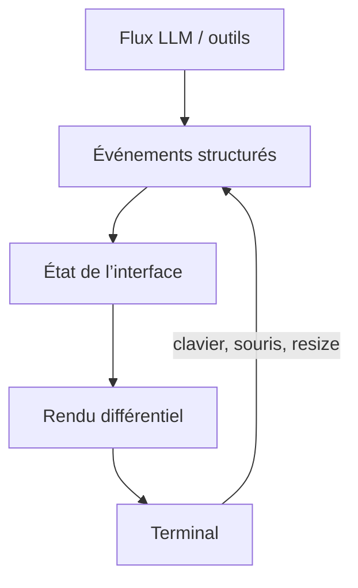

# Affichage dynamique TUI CLI

**User:** Anonymous  
**Created:** 8/6/2026 8:49:48  
**Updated:** 8/6/2026 8:53:04  
**Exported:** 8/6/2026 8:53:15  
**Link:** [https://chatgpt.com/c/6a742e72-1190-83ed-9be6-4494206f507b](https://chatgpt.com/c/6a742e72-1190-83ed-9be6-4494206f507b)  

## Response:
06/08/2026 08:49:48

Je vais d’abord identifier les comportements précis de l’interface CLI d’Amp (streaming, blocs d’outils, réécriture en place), puis te proposer une architecture reproductible.

> **Searching ampcode.com**
>
>
> **Searched 9 websites**
>
> 
>
> Worked for 59s

Pour obtenir un affichage dynamique proche d’Amp, il faut construire une vraie **TUI** (*Terminal User Interface*), et non simplement enchaîner des `console.log()`.

Amp fonctionne aujourd’hui comme une interface plein écran capable de gérer le streaming, le défilement, la souris, des fenêtres superposées et des boutons cliquables. Leur framework exact est interne, mais l’architecture peut être reproduite. [Amp décrit son approche ici](https://ampcode.com/news/look-ma-no-flicker).

### Architecture recommandée

Sépare ton application en trois couches :

1. **Événements** : tokens du LLM, début/fin d’un outil, logs, erreurs.
2. **État** : messages, outil actif, progression, texte en cours.
3. **Rendu TUI** : l’écran est recalculé lorsque l’état change.



Évite que le code métier écrive directement sur `stdout`. Il doit produire des événements :

```ts
type UiEvent =
  | { type: "token"; text: string }
  | { type: "tool-start"; name: string }
  | { type: "tool-output"; text: string }
  | { type: "tool-end"; success: boolean }
  | { type: "error"; message: string };
```

### Le choix le plus simple en TypeScript

Utilise **Ink**, qui permet de construire une CLI avec un modèle de composants proche de React :

```bash
npm install ink react
npm install -D typescript tsx @types/react
```

```tsx
// cli.tsx
import React, { useEffect, useState } from "react";
import { render, Box, Text, useInput } from "ink";

function App() {
  const [answer, setAnswer] = useState("");
  const [running, setRunning] = useState(true);

  useInput((input, key) => {
    if (input === "q" || key.escape) process.exit(0);
  });

  useEffect(() => {
    const tokens = [
      "J’analyse ", "le projet…\n",
      "✓ Lecture des fichiers\n",
      "✓ Vérification du code\n\n",
      "Voici le résultat."
    ];

    let index = 0;

    const timer = setInterval(() => {
      if (index === tokens.length) {
        clearInterval(timer);
        setRunning(false);
        return;
      }

      setAnswer(current => current + tokens[index++]);
    }, 300);

    return () => clearInterval(timer);
  }, []);

  return (
    <Box flexDirection="column">
      <Box borderStyle="round" borderColor="cyan" paddingX={1}>
        <Text bold color="cyan">Mon Agent</Text>
      </Box>

      <Box marginTop={1}>
        <Text>{answer}</Text>
      </Box>

      <Box marginTop={1}>
        <Text color={running ? "yellow" : "green"}>
          {running ? "● Réflexion en cours…" : "✓ Terminé"}
        </Text>
      </Box>

      <Text dimColor>Échap ou q pour quitter</Text>
    </Box>
  );
}

render(<App />);
```

Exécution :

```bash
npx tsx cli.tsx
```

Ink s’occupe de ne mettre à jour que les lignes modifiées, ce qui évite le scintillement.

### Pour une interface vraiment comparable à Amp

Ink devient parfois limitant pour un transcript complexe et une navigation plein écran. Dans ce cas, je choisirais :

- **Rust + Ratatui + Crossterm** : meilleur contrôle et excellentes performances.
- **Go + Bubble Tea** : architecture événementielle très agréable.
- **TypeScript + OpenTUI** : intéressant si tu veux rester dans l’écosystème JS.
- **ANSI manuel** : seulement pour un spinner ou une ligne de progression.

Les éléments importants à implémenter sont :

- alternate screen avec restauration garantie à la sortie ;
- mode raw pour traiter les touches immédiatement ;
- rendu différentiel ou double buffering ;
- gestion de `SIGINT`, erreurs et redimensionnement ;
- transcript scrollable séparé de la zone de saisie ;
- cadence de rendu limitée à environ 30–60 FPS ;
- regroupement des tokens reçus pour éviter un rendu par caractère ;
- sortie JSONL séparée pour le mode non interactif.

Cette dernière séparation est utile : Amp expose justement un mode `--stream-json` où chaque événement est écrit en JSON sur une ligne, indépendamment de son interface interactive. [Documentation officielle d’Amp](https://ampcode.com/manual).

Pour un prototype rapide, prends **Ink**. Pour reproduire fidèlement le plein écran, le scroll fluide et les overlays d’Amp, prends plutôt **Ratatui** ou **Bubble Tea**.

## Response:
06/08/2026 08:52:14

En Python, le meilleur choix pour reproduire une interface proche d’Amp est **Textual**. C’est une vraie TUI asynchrone avec composants, CSS, clavier, souris, défilement et mises à jour dynamiques.

```bash
pip install textual
```

Exemple complet avec réponse en streaming et blocs d’outils :

```python
# app.py
import asyncio

from textual.app import App, ComposeResult
from textual.containers import VerticalScroll
from textual.widgets import Footer, Header, Input, Label, Static

class AgentCLI(App):
    CSS = """
    Screen {
        background: #0d1117;
    }

    #transcript {
        height: 1fr;
        padding: 1 2;
    }

    .user {
        color: #79c0ff;
        margin-top: 1;
    }

    .assistant {
        color: #f0f6fc;
        margin-bottom: 1;
    }

    .tool {
        color: #8b949e;
        border-left: solid #3fb950;
        padding-left: 1;
        margin: 1 0;
    }

    #status {
        height: 1;
        color: #d29922;
        margin: 0 2;
    }

    #prompt {
        margin: 1 2;
        border: tall #30363d;
    }

    #prompt:focus {
        border: tall #58a6ff;
    }
    """

    BINDINGS = [
        ("ctrl+c", "quit", "Quitter"),
        ("ctrl+l", "clear", "Effacer"),
    ]

    def compose(self) -> ComposeResult:
        yield Header(show_clock=True)

        with VerticalScroll(id="transcript"):
            yield Static(
                "Agent prêt. Posez votre question.",
                classes="assistant",
            )

        yield Label("● Prêt", id="status")
        yield Input(
            placeholder="Demandez quelque chose…",
            id="prompt",
        )
        yield Footer()

    async def on_input_submitted(self, event: Input.Submitted) -> None:
        prompt = event.value.strip()
        if not prompt:
            return

        event.input.clear()
        event.input.disabled = True

        transcript = self.query_one("#transcript", VerticalScroll)
        status = self.query_one("#status", Label)

        await transcript.mount(
            Static(f"Vous › {prompt}", classes="user")
        )

        answer = Static("Agent › ", classes="assistant")
        await transcript.mount(answer)

        status.update("● Réflexion…")
        await transcript.scroll_end(animate=False)

        try:
            await self.run_agent(prompt, answer, transcript, status)
        finally:
            status.update("● Prêt")
            event.input.disabled = False
            event.input.focus()

    async def run_agent(
        self,
        prompt: str,
        answer: Static,
        transcript: VerticalScroll,
        status: Label,
    ) -> None:
        # À remplacer par les événements de ton véritable agent.
        tokens = [
            "Je vais examiner ",
            "la demande et ",
            "vérifier les fichiers.\n\n",
        ]

        content = "Agent › "

        for token in tokens:
            content += token
            answer.update(content)
            await transcript.scroll_end(animate=False)
            await asyncio.sleep(0.25)

        status.update("● Exécution de read_file…")

        tool = Static(
            "◆ read_file\n"
            "  chemin : src/main.py\n"
            "  ✓ 128 lignes lues",
            classes="tool",
        )
        await transcript.mount(tool)
        await transcript.scroll_end(animate=False)
        await asyncio.sleep(0.8)

        status.update("● Génération…")

        for token in [
            "\nL’analyse est terminée. ",
            "Le projet peut être modifié ",
            "sans changer son architecture.",
        ]:
            content += token
            answer.update(content)
            await transcript.scroll_end(animate=False)
            await asyncio.sleep(0.2)

    def action_clear(self) -> None:
        transcript = self.query_one("#transcript", VerticalScroll)
        transcript.remove_children()

if __name__ == "__main__":
    AgentCLI().run()
```

Lance-le avec :

```bash
python app.py
```

Pour brancher un vrai flux LLM, remplace `tokens` par un itérateur asynchrone :

```python
async for event in agent.stream(prompt):
    if event.type == "text_delta":
        content += event.text
        answer.update(content)

    elif event.type == "tool_start":
        status.update(f"● Exécution de {event.name}…")

    elif event.type == "tool_output":
        await transcript.mount(
            Static(event.output, classes="tool")
        )

    await transcript.scroll_end(animate=False)
```

Pour rester fluide, ne rafraîchis pas nécessairement l’écran à chaque caractère : accumule les tokens pendant 16 à 40 ms avant d’appeler `update()`.

Alternatives :

- **Rich Live** : excellent pour un affichage dynamique simple, sans zone de saisie élaborée.
- **prompt_toolkit** : très puissant pour l’éditeur de commande et l’autocomplétion.
- **Textual** : meilleur choix global pour une TUI plein écran comparable à Amp.
- **Urwid** : mature, mais moins agréable pour un nouveau projet.


---
Powered by [ChatGPT Exporter](https://www.chatgptexporter.com)